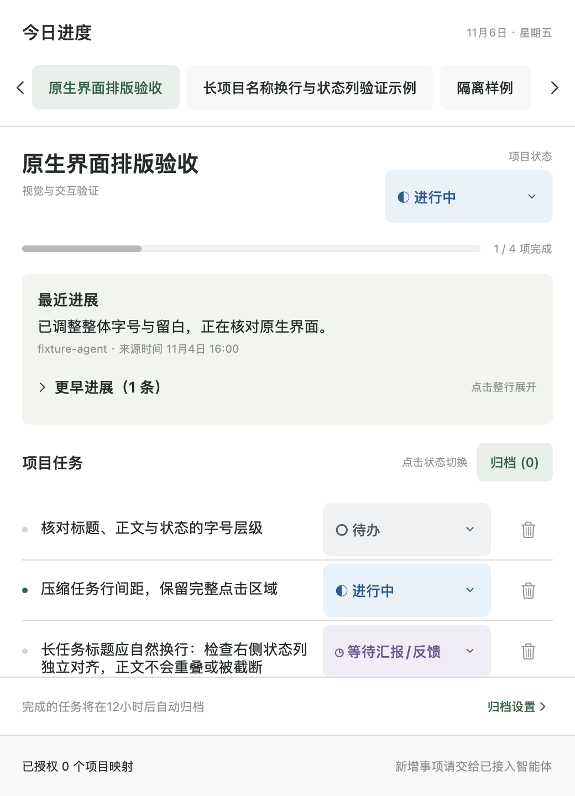

# Workdesk · 工作进度台

Workdesk 是原生 macOS 工作台，用菜单栏与置顶悬浮窗汇总项目任务、智能体进度和待审核的会议事项。

**当前正式版：[v1.0.0（build 2）](https://github.com/yangligei/workdesk/releases/tag/v1.0.0)** · [中文用户指南](docs/user-guide.md) · [智能体接入指南](docs/agent-integration-guide.md) · [更新记录](CHANGELOG.md)

## 下载与安装

仓库为私有仓库，以下链接需要登录有访问权限的 GitHub 账号。

1. 在 [v1.0.0 发布页](https://github.com/yangligei/workdesk/releases/tag/v1.0.0) 下载 `Workdesk-v1.0.0-macos-arm64.zip` 与 `SHA256SUMS.txt`。
2. 在下载目录运行 `shasum -a 256 Workdesk-v1.0.0-macos-arm64.zip`，与校验文件中的对应行比较。
3. 解压，将 `Workdesk.app` 放入“应用程序”并打开。移动应用后需重新核对 MCP 配置中的可执行文件路径。
4. 从菜单栏进入“设置与接入”，保存本机身份与授权范围，再连接智能体创建首个项目。

最低系统要求为 **macOS 13+**，发布包仅支持 **Apple Silicon（arm64）**。本次发布验收环境为 macOS 27.0.1 / Apple Silicon，未在 macOS 13 或 Intel 实机运行。应用为 ad-hoc 签名，未经 Apple Developer ID 签名或公证；若 Gatekeeper 阻止打开，请先核实来源，再通过系统“隐私与安全性”中的“仍要打开”处理。

## 使用手册

- **最新图文手册**：在 GitHub 打开 [HTML 文件](docs/manual/workdesk-user-manual.html)，点右上角 **Download raw file** 保存后离线阅读。图片已内嵌，可放大和打印。
- GitHub 不会把 HTML 渲染成网页，因此上面的源码链接显示的是代码；同样内容的 Markdown 版可直接阅读：[中文用户指南](docs/user-guide.md)。
- 发布页同时附有 [Workdesk-v1.0.0-manual-zh.html](https://github.com/yangligei/workdesk/releases/download/v1.0.0/Workdesk-v1.0.0-manual-zh.html)，是发布时的固定快照，其归档时机段落已过时；请以仓库最新手册为准。
- 手册的配图来源、重建方法与浏览器实测记录见[手册说明](docs/manual/README.md)。



上图取自生产视图的内存隔离样例，不含真实个人项目；其余界面与操作示意见图文手册。

## 主要功能

- **原生工作台**：中文菜单栏、置顶窗与管理窗口；可编辑项目名称、阶段和任务标题，查看最近进展。
- **五种独立状态**：待办、进行中、等待汇报/反馈、阻塞、完成。项目与任务分别保存状态；智能体上报的文字不会改变正式状态。
- **完成事项归档**：默认完成后满 12 小时自动归档。应用运行时为最近到期事项安排一次性定时器，启动与系统唤醒时补扫；支持恢复为待办和删除。
- **会议智能审核**：保存会议文字原文，调用本机 Hermes 生成建议，核对证据后人工审核，按已有项目权限写入。当前没有应用内录音或音频转写。
- **智能体接入**：签名事件、范围授权、去重与真实回执；本机 stdio MCP 固定提供四个工具。

| MCP 工具 | 用途 |
| --- | --- |
| `workdesk_projects` | 查询当前身份已授权的项目 |
| `workdesk_progress` | 记录进展，不改变任务状态 |
| `workdesk_task_create` | 新增待办，需要单独授权 |
| `workdesk_project_create` | 创建项目并绑定，需要本机创建许可 |

项目和任务由已登记并获授权的智能体创建，界面不提供手动新增。首次在连接中心保存范围后持续有效；创建项目默认关闭，新增待办需单独允许。MCP 不提供自行授权、完成任务或修改状态的工具。接入步骤、完整输入 schema 与可复制提示词见[智能体接入指南](docs/agent-integration-guide.md)。

四个工具已用隔离 stdio 验证，各客户端仍须在当前会话发现工具、实际调用并核对回执；QQ 需额外配置与独立验证。会议识别依赖本机可用的 Hermes 配置与网络。客户端验证范围见[连接中心说明](docs/mcp-connections.md)，其余限制见[v1.0.0 验收报告](docs/releases/v1.0.0-validation.md)。

## 从源码构建

要求 macOS 13+、Swift 5.9+ 与 Xcode Command Line Tools；界面为 SwiftUI + AppKit，数据使用系统 SQLite，无第三方运行时依赖。克隆私有仓库需要 GitHub 访问权限。

```sh
git clone https://github.com/yangligei/workdesk.git
cd workdesk
swift build
swift run CoreChecks
bash scripts/build-app.sh
open dist/Workdesk.app
```

`swift build` 同时生成检查使用的 WorkdeskCLI 子进程。完整 Xcode 环境还可执行 `swift test`；仅 Command Line Tools 的机器可能缺少 XCTest，发布验收使用可执行的 `CoreChecks`。打包脚本生成本机架构的 Release `.app` 并作 ad-hoc 本地签名。

默认数据位于 `~/Library/Application Support/Workdesk/workdesk.sqlite`，可用 `WORKDESK_DATA_DIR` 指定隔离目录。关闭窗口不结束进程，需从菜单栏选择“退出 Workdesk”；应用退出期间到期的事项在下次启动补扫。

## 文档导航

| 需要什么 | 文档 |
| --- | --- |
| 安装后的日常使用、归档与备份 | [中文用户指南](docs/user-guide.md) |
| 让智能体连接、上报进度或创建项目 | [智能体接入操作指南](docs/agent-integration-guide.md) |
| 配置客户端、首次授权与撤销 | [MCP 连接中心](docs/mcp-connections.md) · [首次点击授权](docs/click-onboarding.md) |
| 签名事件与回执格式 | [事件协议](docs/event-protocol.md) |
| 会议识别与审核规则 | [会议 AI](docs/meeting-ai.md) |
| 版本范围与实际验收 | [更新记录](CHANGELOG.md) · [v1.0.0 验收](docs/releases/v1.0.0-validation.md) |
| 参与维护 | [开发计划](docs/roadmap.md) · [轻量架构](docs/architecture.md) · [简要需求](docs/requirements.md) · [开发约束](AGENTS.md) |

## 维护约定

`main` 是当前维护入口，`v1.0.0` 标签固定对应已发布源码；发布后的文档勘误在 `main` 更新，不改动已校验的发布资产与标签。功能与修复使用 `feat/*`、`fix/*` 分支并经 PR 合并，提交说明目的和实际验证结果。密钥、录音、聊天记录、用户数据库、私人验收资料及构建产物不提交。

交互思路参考 [SwiftBar](https://github.com/swiftbar/SwiftBar)、[Übersicht](https://github.com/felixhageloh/uebersicht)、[floating-todo](https://github.com/BUG-gao/floating-todo)，未复制其代码；复用前需核对具体文件与许可证。
