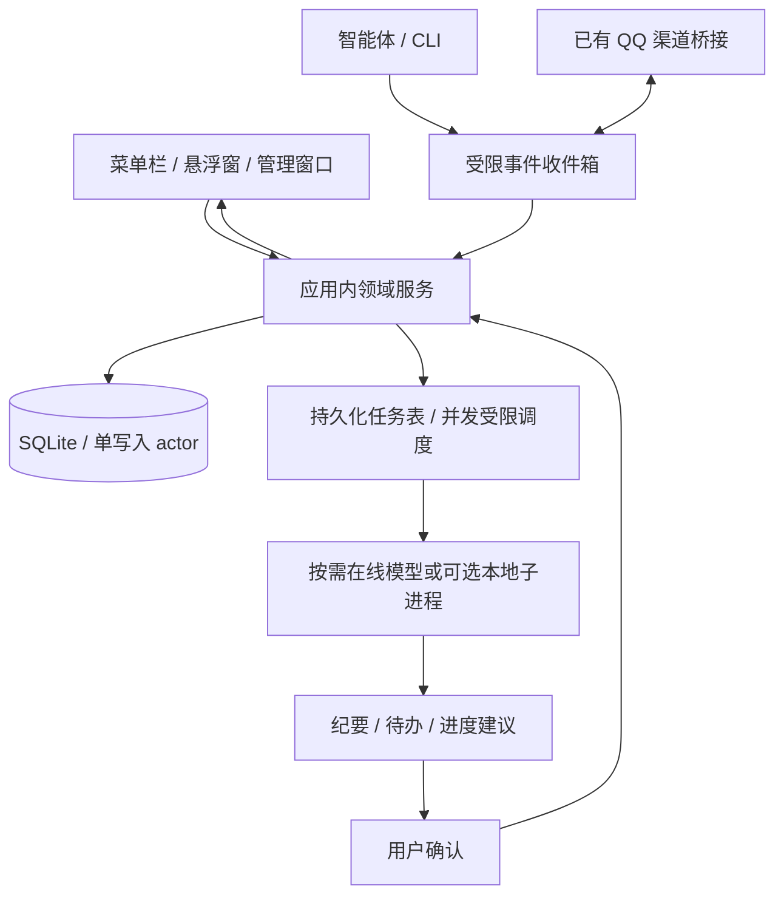

# 轻量架构 v0.2

## 决策

撤销前版独立核心后台、XPC 和常驻 Worker 的首版设计。采用一个原生 macOS 应用进程；SwiftUI + AppKit，Swift concurrency 执行非 UI 工作，SQLite 经单一存储 actor 访问。首版不引入微服务、Redis、WebView、云数据库或强制模型运行时。

## 生命周期

关闭管理窗口不退出应用；菜单栏应用持续接收事件。明确退出后停止处理，重启恢复持久化任务。默认不注册独立 LaunchAgent，不强制开机启动；开机启动由用户选择。Mac 休眠/关机时不承诺实时。若要求离线 QQ 收件由已有桥接持久化，不能假设 QQ 重投无限可靠。

## 模块

- Presentation：菜单栏/NSPanel 置顶窗口/管理窗口；仅渲染必要视图。
- Domain：项目、任务、事件、建议、版本冲突和权限；不包含模型 SDK。
- Storage：系统 SQLite，事务、迁移和备份；仅应用写正式数据库。
- Integrations：通用事件协议、智能体适配、QQ 渠道适配；按实际公开能力验证。
- Jobs：SQLite 保存任务状态，应用内异步执行，重任务并发默认 1；取消、退避重试、重启恢复。外部请求超时可能仍产生费用，避免盲目重试。
- AIProviders：URLSession 在线调用；本地转写可选临时子进程，仅任务期间存在。服务令牌存钥匙串。

## 智能体接入协议

首版采用本机受限目录的原子事件文件收件箱，不开 HTTP 监听端口。小型 Swift CLI 作为短命令写入；目录变化触发读取，启动时补扫。生产者先写临时文件再原子重命名；应用在数据库提交成功后归档/删除。拒绝符号链接和越界路径，限制文件大小及结构。CLI 不直接写数据库；查询使用应用生成的脱敏项目快照，可显式等待回执。

事件：schema_version、event_id、source_id、project_id、task_id（可选）、occurred_at、type、payload、expected_version（修改命令时）。去重键 source_id+event_id。来源时间与接收时间均保留，旧事件不直接回退正式状态。

目录权限只隔离不同系统用户；不能防同一 macOS 用户下恶意进程伪造。按来源令牌与项目授权减少误用，不声称强沙箱隔离。外部文本作为数据处理，不执行其夹带指令。

## QQ 接入

不新建机器人服务，先验证已有渠道是否提供可靠扩展点。桥接通过统一命令进入收件箱，并消费带 request_id 的限定回复；非任意文件读取接口。确认发件人、去重消息、限定项目，输出按渠道授权过滤。若现有渠道不支持桥接，再评估小型出站连接适配器；不默认暴露 Mac 公网端口。不得直接依赖 Hermes 私有内部模块。现有渠道的内存和网络成本单独计量，不计入本应用预算来掩盖总成本。

## 进度与 AI

ProgressEvent 是不可变记录；Project/Task 是正式状态；Proposal 是待确认变更；Snapshot 是可重建缓存。操作审计与对象版本同时记录。事务内验证 expected_version。阶段变化和完成状态不因会话结束自动生效。AI 总结由显式请求或一批变化后触发，按输入指纹缓存；无人查看时不持续生成总结。

## 数据

Project、Task、ProgressEvent、AgentSession、SourceBinding、Proposal、Meeting、TranscriptSegment、Job、AuditLog。附件仅在获授权目录保存引用；原音频保留策略用户选择。按项目限定来源，其他人的工作空间隔离。

## 性能与可靠性

事件合并刷新 UI；无高频轮询。索引覆盖项目+时间、待办状态、事件去重键；列表分页。LLM 上下文限量，旧事件按需读取。备份用 SQLite backup API 或一致性快照，不能仅复制运行中的 db 文件漏掉 WAL。日志滚动并去除敏感字段。

## 验证

去重/乱序/重启恢复、冲突、恶意或超大事件文件、授权越界、会议草稿确认均需测试。QQ、模型和智能体端到端测试分别执行；模拟结果不能代替真实接入成功。性能按 requirements.md 预算实测。
